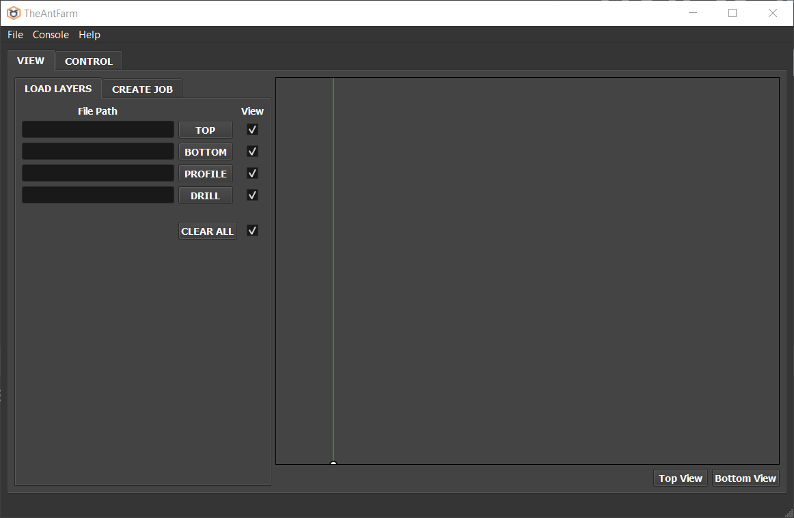
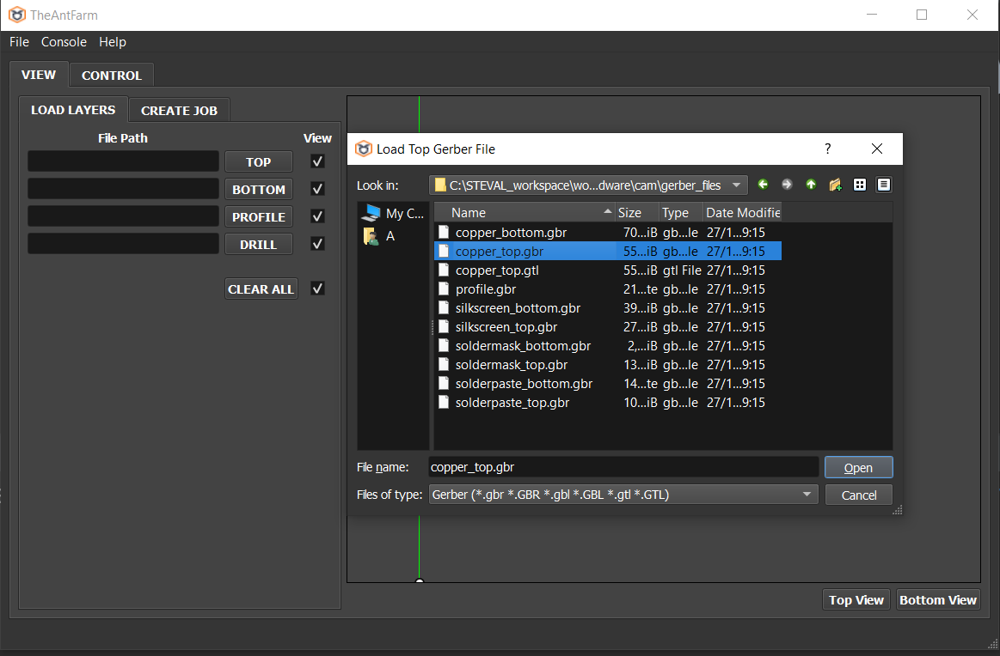
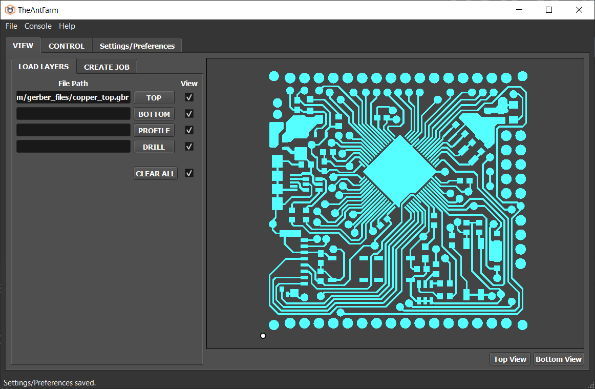
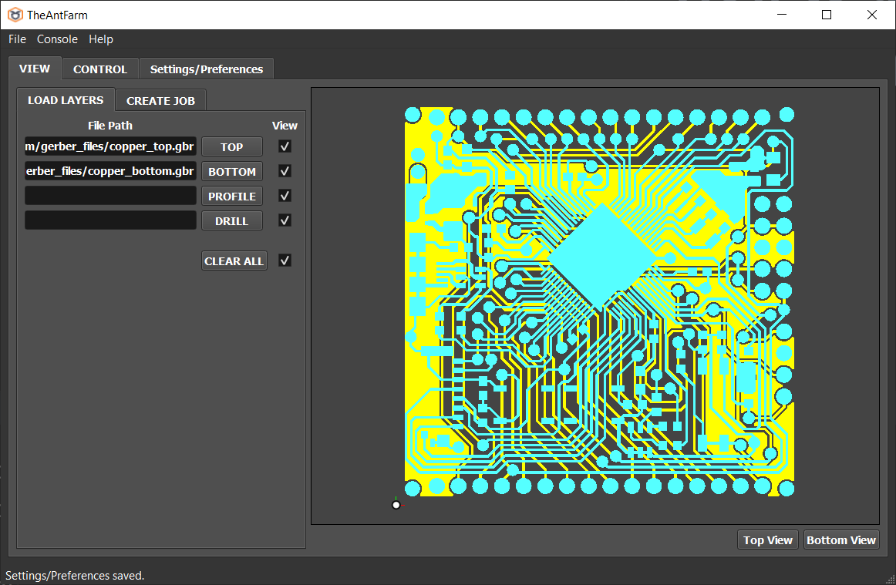
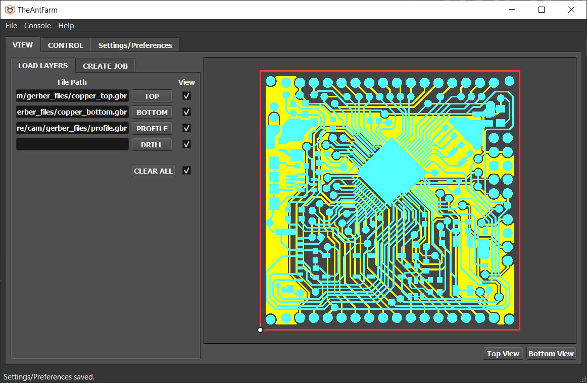
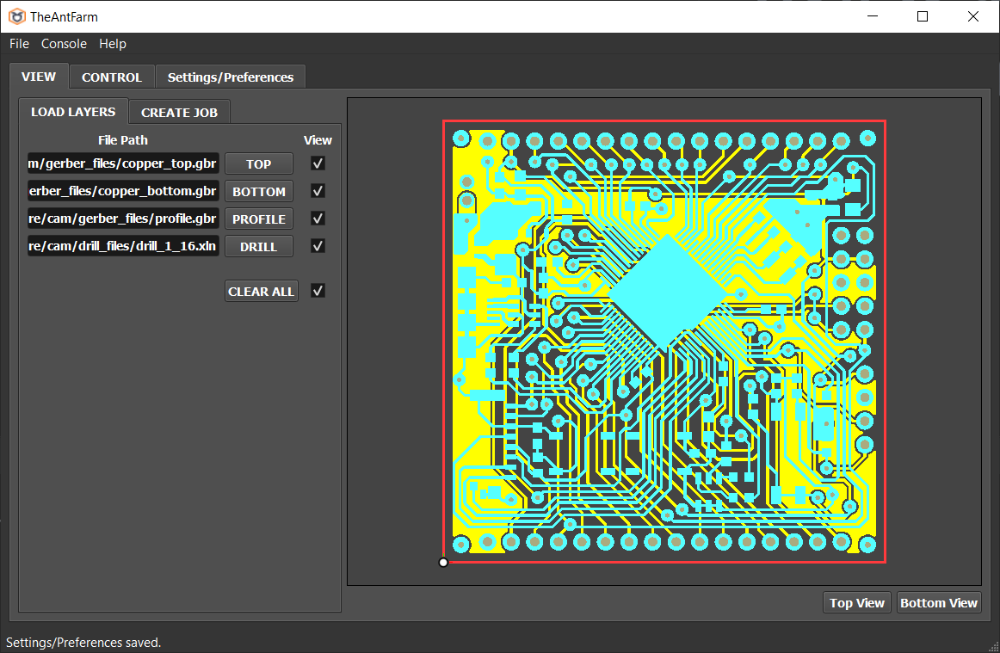
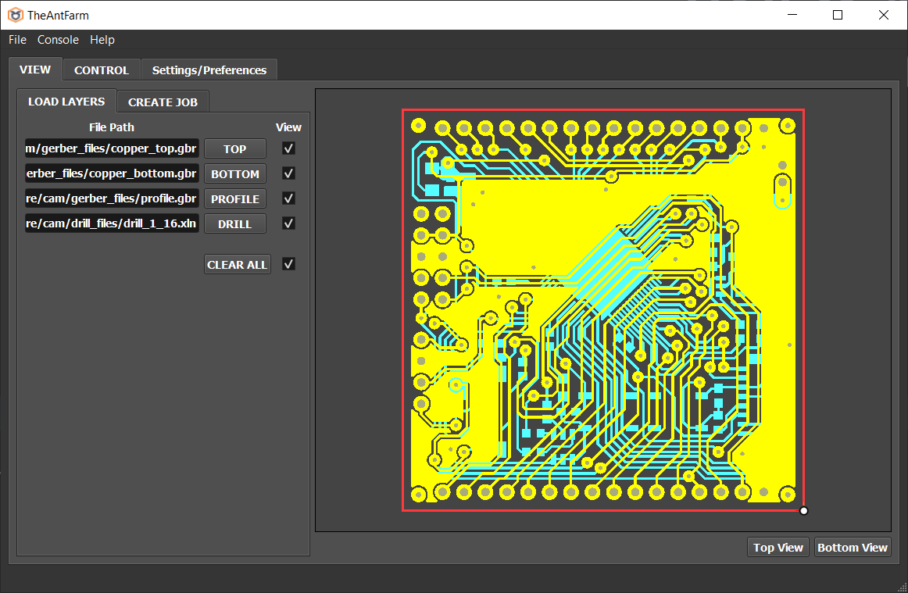

# Loading Gerber and Excellon layers

The **VIEW › LOAD LAYERS** tab loads the files exported by the PCB design tool. Each button loads one layer:

| Button | File | Used for |
|---|---|---|
| **TOP** | Gerber of the top copper | isolation milling of the top side |
| **BOTTOM** | Gerber of the bottom copper | isolation milling of the bottom side |
| **PROFILE** | Gerber of the board outline | cutting the board out |
| **DRILL** | Excellon drill file | drilling the holes |

Load each file with its own button. The layer decides which settings the job gets: a profile loaded as TOP
is shown, but its job would be an isolation job instead of a cut.

> The screenshots on this page come from an older version; the layout is the same.

## Loading a layer

Press the button of the layer. A file dialog opens; choose the file and press **Open**. For example, TOP:

The layer is drawn in the view and its path is shown next to the button:

Load the other layers in the same way. They are drawn together, each in its own colour:

The DRILL dialog lists the Excellon files first. A large drill file can take a few seconds to appear.

## Looking at the layers

- **Top View** and **Bottom View**, under the view, show the board from either side.
- The **View** check box next to each button hides or shows that layer; the one next to **CLEAR ALL** hides or
  shows all of them.
- **CLEAR ALL** removes every loaded layer.
- The layer colours can be changed in **Settings/Preferences › Application Settings › LAYER COLORS**.

## Next

[Creating a job](creating-a-job.md) turns the loaded layers into G-code.
